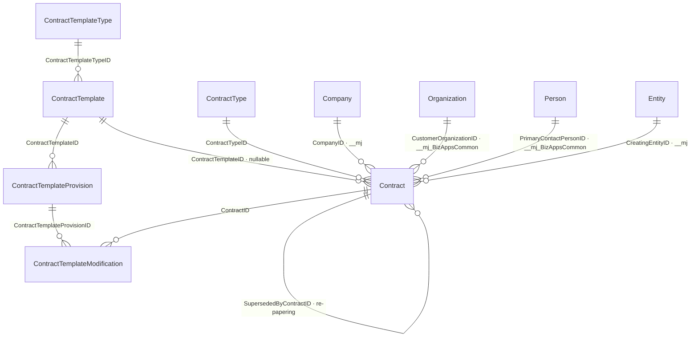

# `bizapps-contracts` — ERD (as built)

> **This is the AS-BUILT ERD — a reflection of the implementation, not a plan.** It describes what
> the database contains; schema that is planned but not built does not belong here. The *reasoning*
> behind the shape — the decisions, and the R-1…R-19 reversal log — is recorded, as history, in
> [`plans/ERD-planned.md`](../plans/ERD-planned.md). This file answers "what is there", that one
> answers "why".
>
> **TAKEN FROM THE FULL MIGRATION CHAIN.** Every table, column, nullability, foreign key, `CHECK` and
> index below is the end state of `migrations/B202608040001…` through `V202609211200…`, each later
> file applied over the earlier ones. Later migrations redefine `vwContracts`; §4 describes the
> latest definition (`V202609211200`).
>
> **It is checked, not trusted.** `npx tsx test-harnesses/erd-schema-diff.ts` diffs the diagram's
> columns and the counts below against a live database and exits non-zero on drift. Run it after any
> migration. A previous revision of this file described the **v1** schema for a day after v1 was
> retired, and nothing about reading it revealed that — which is why the check exists.

**6 tables** · 8 internal relationships · 4 cross-app foreign keys · 17 CHECK constraints · 6 unique indexes.

Schema: `__mj_BizAppsContracts`. Entity name prefix: `MJ_BizApps_Contracts: `.

---

## 1. The whole model

```mermaid
erDiagram
    ContractTemplateType {
        uuid ID PK
        nvarchar Name "unique"
        nvarchar Description "nullable"
        nvarchar Status "Active or Inactive"
    }

    ContractTemplate {
        uuid ID PK
        nvarchar Name "unique"
        uuid ContractTemplateTypeID FK "ContractTemplateType"
        nvarchar VersionLabel "nullable"
        date IntroducedDate "nullable"
        nvarchar SourceURL "nullable · where the text of this version lives"
        nvarchar Description "nullable"
        nvarchar Status "Draft or Published"
    }

    ContractTemplateProvision {
        uuid ID PK
        uuid ContractTemplateID FK "ContractTemplate"
        nvarchar ProvisionNumber "unique within the template"
        nvarchar Title "the clause heading"
        nvarchar ProvisionText "nvarchar-max · the standard clause · required, non-blank"
        nvarchar Description "nullable"
        nvarchar ProvisionSortKey "nullable · persisted computed column · collatable key derived from ProvisionNumber · display order"
    }

    ContractType {
        uuid ID PK
        nvarchar Name "unique"
        nvarchar Description "nullable"
        bit RequiresExecutedDocument "drives IsAwaitingDocument"
        nvarchar Status "Active or Inactive"
        bit MustBeRoot "this type may not name a parent"
        bit MustBeChild "this type MUST name a parent · change orders"
        bit TemplateRequired "this type must cite a ContractTemplate"
        bit DefaultAutoRenew "nullable · seeds Contract.AutoRenew on a new contract"
        int DefaultRenewalNoticeDays "nullable · seeds Contract.RenewalNoticeDays"
        int DefaultCancellationWindowDays "nullable · seeds Contract.CancellationWindowDays"
        decimal DefaultAnnualIncreasePercent "nullable · seeds Contract.AnnualIncreasePercent"
    }

    Contract {
        uuid ID PK
        nvarchar ContractNumber "nullable · unique · CTR-nnnnnn · minted server-side"
        uuid ContractTypeID FK "ContractType"
        uuid CompanyID FK "__mj.Company · the SELLING entity"
        uuid CustomerOrganizationID FK "__mj_BizAppsCommon.Organization"
        uuid PrimaryContactPersonID FK "__mj_BizAppsCommon.Person · nullable"
        uuid ContractTemplateID FK "ContractTemplate · nullable"
        uuid CreatingEntityID FK "__mj.Entity · nullable"
        nvarchar CreatingRecordID "nvarchar450 · nullable · the Deal"
        uuid ParentContractID FK "self · nullable · change orders"
        uuid SupersededByContractID FK "self · nullable · re-papering"
        nvarchar SigningProviderURL "nullable · direct PandaDoc link"
        date EffectiveDate "nullable"
        date ExecutedDate "nullable"
        date EndDate "nullable"
        date TerminatedDate "nullable"
        bit AutoRenew "default 0"
        int RenewalNoticeDays "nullable"
        int CancellationWindowDays "nullable"
        decimal AnnualIncreasePercent "nullable"
        bit HasModifications "default 0 · monotonic"
        nvarchar Description "nullable"
        nvarchar Notes "nullable"
        decimal PredictedNonRenewalRisk "nullable · predicted probability of non-renewal, 0 to 1"
        nvarchar PredictedRenewalRiskBand "nullable · Low, Medium, High or Critical"
        datetimeoffset PredictedRenewalScoredAt "nullable · when the contract was last scored"
    }

    ContractTemplateModification {
        uuid ID PK
        uuid ContractID FK "Contract"
        uuid ContractTemplateProvisionID FK "ContractTemplateProvision"
        nvarchar ModificationText "nvarchar-max · what THIS contract says · required, non-blank"
        nvarchar Notes "nullable"
    }
```

Every table also carries `__mj_CreatedAt` and `__mj_UpdatedAt` (`datetimeoffset`, defaulted and
trigger-maintained). CodeGen owns them; they are omitted from the diagrams so the real content is
readable.

The four `ContractType.Default*` columns are a starting point, not a rule: when an unsaved contract
picks a type, each renewal field the user has not edited takes the type's default. Nothing reads them
at save time.

## 2. The links

**8 internal foreign keys** (the first eight above) and **4 cross-app** (the last four). No FK leaves
this schema except those four, and none points into `bizapps-sales` — sales depends on contracts, so
the deal reference is the soft `CreatingEntityID` + `CreatingRecordID` pair rather than a hard FK.

`ContractNumber` is minted by `spAssignNextContractNumber` from the schema-owned SQL sequence
`seq_ContractNumber` (`NO CACHE`, so a restart cannot make the numbers jump), which
`ContractEntityServer.Save()` calls when a new contract arrives without a number. The column is
nullable because MJ cannot declare "NOT NULL, assigned by the server on insert" (MJ#4001); the plain
`UQ_Contract_ContractNumber` admits at most one NULL. The `ContractSequence` counter TABLE the
sequence replaced was removed in the 2026-08-23 flatten, which folded the earlier migrations into the
baseline — a table was a full MJ entity, so anyone with entity permission could rewrite or delete the
counter; a sequence has no such surface.

## 3. Constraints

### 3.1 CHECK — 17

| Table | Constraint | Rule |
|---|---|---|
| `Contract` | `CK_Contract_Dates` | `EndDate >= EffectiveDate` when both are set |
| `Contract` | `CK_Contract_ParentNotSelf` | `ParentContractID <> ID` |
| `Contract` | `CK_Contract_SupersededNotSelf` | `SupersededByContractID <> ID` |
| `Contract` | `CK_Contract_CreatingPairBothOrNeither` | `CreatingEntityID` and `CreatingRecordID` are both set or both null |
| `Contract` | `CK_Contract_RenewalNoticeDays` | null or `>= 0` |
| `Contract` | `CK_Contract_CancellationWindow` | null or `>= 0` |
| `Contract` | `CK_Contract_AnnualIncrease` | null or `>= 0` |
| `Contract` | `CK_Contract_PredictedRenewalRiskBand` | null or `IN ('Low','Medium','High','Critical')` |
| `ContractType` | `CK_ContractType_Status` | `IN ('Active','Inactive')` |
| `ContractType` | `CK_ContractType_RootOrChild` | `NOT (MustBeRoot = 1 AND MustBeChild = 1)` — a type cannot be both |
| `ContractType` | `CK_ContractType_DefaultRenewalNoticeDays` | null or `>= 0` |
| `ContractType` | `CK_ContractType_DefaultCancellationWindow` | null or `>= 0` |
| `ContractType` | `CK_ContractType_DefaultAnnualIncrease` | null or `>= 0` |
| `ContractTemplateType` | `CK_ContractTemplateType_Status` | `IN ('Active','Inactive')` |
| `ContractTemplate` | `CK_ContractTemplate_Status` | `IN ('Draft','Published')` |
| `ContractTemplateProvision` | `CK_ContractTemplateProvision_TextNotBlank` | `LEN(LTRIM(RTRIM(ProvisionText))) > 0` |
| `ContractTemplateModification` | `CK_ContractTemplateModification_TextNotBlank` | `LEN(LTRIM(RTRIM(ModificationText))) > 0` |

The seven baseline `Contract` constraints have a **generated `Validate()` counterpart** on
`mjBizAppsContractsContractEntity`, and so do the two `TextNotBlank` constraints and
`CK_ContractType_RootOrChild`, so violating any of them produces a field-named message rather than a
raw SQL error. The three `CK_ContractType_Default*` constraints have no counterpart in the committed
generated code; SQL Server is what refuses a negative default.

The four `IN (…)` constraints do **not** become validators: CodeGen renders those as
`ValueListType='List'` metadata (which drives the UI dropdown), and `BaseEntity` does not validate
value lists — filed as [MJ#3969](https://github.com/MemberJunction/MJ/issues/3969). The shared
`ContractType`, `ContractTemplateType` and `ContractTemplate` subclasses check their `Status` lists
themselves (`value-list-validation.ts`). Nothing checks `PredictedRenewalRiskBand` before SQL Server
does; its value list ships in `V202610092200__…__Risk_band_value_list.sql`.

### 3.2 Unique — 6

| Table | Index | Columns |
|---|---|---|
| `Contract` | `UQ_Contract_ContractNumber` | `ContractNumber` |
| `ContractTemplate` | `UQ_ContractTemplate_Name` | `Name` |
| `ContractTemplateProvision` | `UQ_ContractTemplateProvision_Template_Number` | `ContractTemplateID, ProvisionNumber` |
| `ContractTemplateModification` | `UQ_ContractTemplateModification_Contract_Provision` | `ContractID, ContractTemplateProvisionID` |
| `ContractType` | `UQ_ContractType_Name` | `Name` |
| `ContractTemplateType` | `UQ_ContractTemplateType_Name` | `Name` |

`UQ_ContractTemplateModification_Contract_Provision` is the one a user can reach by ordinary use: it
says a contract records **at most one** modification per provision.

### 3.3 Non-unique indexes

`IX_Contract_CreatingRecord` on `(CreatingEntityID, CreatingRecordID)` — the reverse lookup "which
contract came from this deal?". `IX_ContractTemplateProvision_SortKey` on
`(ContractTemplateID, ProvisionSortKey)` — a template's clauses in document order. CodeGen
additionally creates an `IDX_AUTO_MJ_FKEY_*` index on every foreign key column.

## 4. Derived columns — not in any table

`vwContracts` is an **app-owned layered base view**: it wraps the CodeGen-generated
`vwContractsGenerated` and adds thirteen columns computed at read time. They appear on the
`Contracts` entity as read-only virtual fields, and they are the only place these facts exist.

**"Today" is the business day:** `bt.Today` from bizapps-common's
`[__mj_BizAppsCommon].[fnBusinessToday]()` — the calendar day in the time zone of the instance's
`BizApps.BusinessTimeZone` setting, or the UTC day while that setting is empty (its shipped
state) — cross-joined once per query, so every column in a row uses the same day.

| Column | Derived from |
|---|---|
| `State` | First match wins: `TerminatedDate <= today` → `Terminated`; `SupersededByContractID` set → `Superseded`; `EndDate < today` → `Expired`; `EffectiveDate <= today` → `Active`; `ExecutedDate` set → `Executed`; otherwise `Draft` |
| `IsAwaitingDocument` | `ContractType.RequiresExecutedDocument = 1` AND no file linked through `__mj.FileEntityRecordLink` whose `__mj.FileCategory` is named `Executed Agreement` |
| `DaysToEnd` | `DATEDIFF(day, today, EndDate)` — signed |
| `RenewalNoticeDeadline` | `EndDate - RenewalNoticeDays` |
| `IsInCancellationWindow` | today falls within `CancellationWindowDays` of `EndDate`, `EndDate` included |
| `NonRenewalOutcome` | The renewal-risk model's label. First match wins: superseded → `0`; `TerminatedDate <= today` → `1`; `EndDate < today` → `1`; otherwise null |
| `TermLengthDays` | `DATEDIFF(day, EffectiveDate, EndDate)` |
| `DaysUntilNoticeDeadline` | `DATEDIFF(day, today, RenewalNoticeDeadline)` |
| `HasModificationsFlag` | `HasModifications` as `1` / `0` |
| `AutoRenewFlag` | `AutoRenew` as `1` / `0` |
| `HasParentContract` | `ParentContractID IS NOT NULL` as `1` / `0` |
| `HasCancellationWindow` | `CancellationWindowDays > 0` as `1` / `0` |
| `HasAnnualIncrease` | `AnnualIncreasePercent > 0` as `1` / `0` |

The last eight were added for the renewal-risk model (`V202609202354`). `NonRenewalOutcome` checks
supersession *before* termination, the reverse of `State`: a renewal normally both terminates the old
contract and points it at its successor, and for training that counts as renewed.

Five of the columns depend on **today** — `State`, `DaysToEnd`, `IsInCancellationWindow`,
`NonRenewalOutcome` and `DaysUntilNoticeDeadline` — so they cannot be stored: nothing writes the row
when the clock crosses a boundary. `plans/ERD-planned.md` §7.2 records the reasoning, as history.

`vwContractsGenerated` also carries CodeGen's joined name columns: `ContractType`, `Company`,
`CustomerOrganization`, `PrimaryContactPerson`, `ContractTemplate`, `CreatingEntity`,
`ParentContract` and `SupersededByContract`.

`vwContractTemplates` wraps `vwContractTemplatesGenerated` the same way and adds one column,
`IsUsable`: the template has a non-blank `SourceURL`, or a file is linked to it.

## 5. What this schema deliberately does not have

No `Status` column on `Contract` (derived as `State`), no named document FK (documents attach through
`__mj.FileEntityRecordLink`), no `ContractTemplateID` on a modification (its provision derives the
template), no line items, no billing schedule, no pricing, no commitment tracking and no amendment
workflow. The v1 schema had all of those across 10 tables; v2 is 6. `plans/ERD-planned.md` §9 records
each removal and who ruled it, as history.
