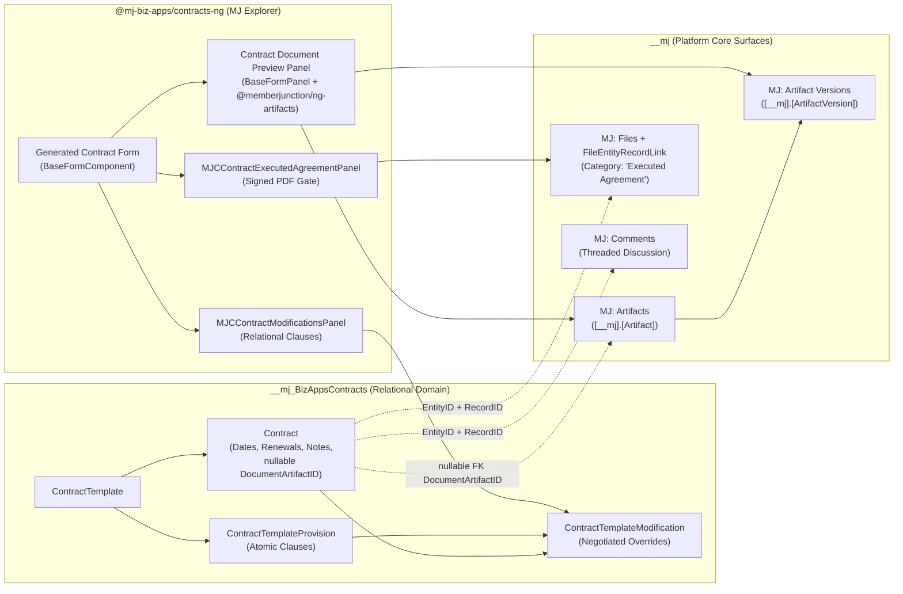

# MJ Docs (`MJ: Artifacts`) vs. `MJ: Comments` vs. Quick Notes — Architecture Rubric

**Status:** Binding for `MemberJunction/bizapps-contracts`  
**Related Spec:** [`.mj/specs/mj-docs-contract-draft-integration.md`](../../.mj/specs/mj-docs-contract-draft-integration.md)  
**Related Policies:** [`CLAUDE.md`](../../CLAUDE.md) · [`AGENTS.md`](../../AGENTS.md) · [`docs/database-migrations.md`](../database-migrations.md) · [`docs/ui-architecture.md`](../ui-architecture.md) · [`docs/claude/04-performance.md`](../claude/04-performance.md)

---

## 1. Executive Summary & Core Principle

BizApps Contracts tracks customer agreements, incorporated standard terms, negotiated deviations, renewal obligations, and executed paper. As AI-assisted drafting, automated review memos, and executive summaries enter the contract lifecycle, engineering and product decisions must maintain a crisp boundary between **versioned rich documents**, **threaded discussion**, **structured relational data**, and **signed binary attachments**.

> **Core Principle:** Store versioned, rich long-form documents (**Assembled Contract Drafts**, **AI Contract Review Memos**, and **Executive Summaries**) in **MJ Docs (`MJ: Artifacts`)** via an optional nullable `Contract.DocumentArtifactID` (`FK -> [__mj].[Artifact]([ID])`), anchor threaded review commentary in **`MJ: Comments`**, retain signed binary PDFs in **`MJ: Files`** (`Executed Agreement` category), and keep atomic **`ContractTemplateProvision`**, **`ContractTemplateModification`**, and **`Contract.Notes`** strictly relational so clause-assembly rules, obligation reporting, and approval routing remain SQL-queryable.

---

## 2. Four-Surface Decision Rubric

| Surface | Backing Store | Primary Use Cases in BizApps Contracts | Query & Lifecycle Properties | What NEVER Belongs Here |
|---|---|---|---|---|
| **MJ Docs (`MJ: Artifacts`)** | `[__mj].[Artifact]` + `[__mj].[ArtifactVersion]` (linked via nullable `Contract.DocumentArtifactID`) | **Assembled Contract Drafts**, **AI Contract Review Memos**, **Executive Summaries** | Multi-version rich Markdown/HTML/structured payloads, AI artifact lineage, sharing/permissions, native preview via `@memberjunction/ng-artifacts` | Atomic clause lookup rows (`ContractTemplateProvision`, `ContractTemplateModification`), renewal dates/rates, or signed binary PDFs that satisfy `IsAwaitingDocument` |
| **`MJ: Comments`** | MemberJunction core entity comments (`__mj` comment entities anchored by Entity + RecordID) | Threaded human/agent negotiation commentary, legal review questions, approval clarifications | Conversational, chronological, mention/reply oriented, anchored to any Contracts entity | Canonical contract clauses, formal versioned contract drafts, or structured obligations |
| **Quick Notes & Relational Columns** | `[__mj_BizAppsContracts].*` (`Contract.Notes`, `ContractTemplateProvision`, `ContractTemplateModification`, etc.) | Atomic standard clauses (`ProvisionText`), negotiated clause overrides (`ModificationText`), short administrative notes (`Contract.Notes`), dates, renewal defaults, lineage FKs | Strictly SQL-queryable, constraint-checked (`CHECK`/`UQ`/FKs), feeds `vwContracts` derived state & renewal-risk features, supports clause-assembly rules and approval routing | Long-form multi-version drafts or ad-hoc duplicated `NVARCHAR(MAX)` document blobs on `Contract` |
| **Executed Paper (`MJ: Files`)** | `[__mj].[File]` + `[__mj].[FileEntityRecordLink]` (`FileCategory.Name = 'Executed Agreement'`) | Countersigned final PDFs and binary exhibits proving legal execution | Drives `vwContracts.IsAwaitingDocument`; managed via MJ stock Attachments + `MJCContractExecutedAgreementPanel` | Unexecuted working drafts or AI-generated review memos |

### Quick Decision Checklist

1. **Does downstream SQL, a derived view (`vwContracts`), clause assembly, obligation reporting, or approval routing need to filter, join, or validate the content?**  
   → **Relational table/column** (`ContractTemplateProvision`, `ContractTemplateModification`, or `Contract` columns).
2. **Is it a short, single-value operational note attached to a contract or modification record?**  
   → **Quick Notes** (`Contract.Notes` or `ContractTemplateModification.Notes`).
3. **Is it a back-and-forth human or agent conversation / negotiation thread on a record?**  
   → **`MJ: Comments`**.
4. **Is it a rich, multi-version long-form document (assembled draft, AI review memo, executive summary) produced or iterated by users or agents?**  
   → **MJ Docs (`MJ: Artifacts`)** linked via `Contract.DocumentArtifactID` (or artifact links) and previewed with `@memberjunction/ng-artifacts`.
5. **Is it the immutable, countersigned legal PDF that clears `IsAwaitingDocument`?**  
   → **`MJ: Files`** linked via `__mj.FileEntityRecordLink` and marked with the `Executed Agreement` file category.

---

## 3. Entity Boundary Matrix

| Entity / Table | Schema | Category | Boundary Rule |
|---|---|---|---|
| `Contract` | `__mj_BizAppsContracts` | Relational Header + Optional MJ Doc Pointer | Owns dates, parties, renewal terms, lineage (`ParentContractID`, `SupersededByContractID`), `Notes` (quick notes), and optional nullable **`DocumentArtifactID` (`FK -> [__mj].[Artifact]([ID])`)** pointing to the linked Assembled Contract Draft / review artifact. Never stores full draft body blobs in a new `NVARCHAR(MAX)` column. |
| `ContractTemplate` | `__mj_BizAppsContracts` | Relational Version Registry | Immutable dated versions of standard agreement terms (`Draft` / `Published`). Cached by `ContractsEngineBase` (`CacheLocal: false` due to cross-entity `IsUsable` column). |
| `ContractTemplateProvision` | `__mj_BizAppsContracts` | Strictly Relational Clause | Atomic numbered clauses (`ProvisionNumber`, `Title`, `ProvisionText`, `ProvisionSortKey`). Must remain relational so clause-assembly rules and UI pickers operate deterministically. |
| `ContractTemplateModification` | `__mj_BizAppsContracts` | Strictly Relational Clause Override | Per-contract negotiated deviations (`ModificationText`, `Notes`, `UQ_ContractTemplateModification_Contract_Provision`). Must remain relational so special-terms queries, obligation reporting, and approval routing stay SQL-queryable. |
| `ContractType` / `ContractTemplateType` | `__mj_BizAppsContracts` | Relational Taxonomy | Governance rules (`RequiresExecutedDocument`, `MustBeRoot`, `MustBeChild`, `TemplateRequired`) and renewal defaults. Cached in `ContractsEngineBase` (`CacheLocal: true`). |
| `ContractOrder` | `__mj_BizAppsContracts` | Relational Cross-App Link | Links `Contract` to `[__mj_BizAppsOrders].[OrderHeader]` for renewal-term propagation (`AnnualIncreasePercent`, `CarryDiscountOnRenewal`). |
| `Artifact` & `ArtifactVersion` | `__mj` | MJ Docs Store | Authoritative versioned document store for Assembled Contract Drafts, AI Contract Review Memos, and Executive Summaries. Unbounded transactional data — **never** globally cached in `ContractsEngineBase`. |
| `File` & `FileEntityRecordLink` | `__mj` | Binary Attachments | Authoritative store for countersigned legal agreements (`FileCategory = 'Executed Agreement'`). Distinct from `Contract.DocumentArtifactID`. |

---

## 4. Architecture & Dataflow Diagram



---

## 5. Schema Evolution, `PUBLISH_NO_BREAK_POLICY.md` & PostgreSQL Parity Guardrails

### 5.1 Strict `PUBLISH_NO_BREAK_POLICY.md` Compliance
MemberJunction's **Publish-Then-No-Breaking-Changes Policy** (`MJ/packages/OpenApp/PUBLISH_NO_BREAK_POLICY.md`) mandates that once an Open App is published, all schema changes within that platform era must be **strictly additive**:

- **Allowed (used here):** Adding nullable `[DocumentArtifactID] UNIQUEIDENTIFIER NULL` on `[__mj_BizAppsContracts].[Contract]` with foreign key `CONSTRAINT FK_Contract_DocumentArtifact FOREIGN KEY ([DocumentArtifactID]) REFERENCES [${mjSchema}].[Artifact]([ID])` and `sp_addextendedproperty` (`MS_Description`).
- **Tolerant Stored Procedures (Pillar 1):** Because `DocumentArtifactID` is nullable, CodeGen emits `@DocumentArtifactID uniqueidentifier = NULL` on `spCreateContract` and `spUpdateContract`. All historical `EXEC` calls and existing callers (`bizapps-sales`, `bizapps-orders`, legacy contracts) continue working unchanged.
- **Forbidden:** Dropping or renaming `Contract.Notes`, `ContractTemplateProvision`, `ContractTemplateModification`, or any existing column/constraint/SP parameter; narrowing column types; or adding a `NOT NULL` column without a database default.

### 5.2 4-Part T-SQL Migration Structure
Every schema migration under `migrations/` obeys [`docs/database-migrations.md`](../database-migrations.md) (implemented for `DocumentArtifactID` in `migrations/V202611261520__v1.2.x__Contract_DocumentArtifactID.sql`):
1. **Part 1 — Hand-Written Additive DDL:** Single `ALTER TABLE [${flyway:defaultSchema}].[Contract] ADD [DocumentArtifactID] UNIQUEIDENTIFIER NULL CONSTRAINT [FK_Contract_DocumentArtifact] REFERENCES [${mjSchema}].[Artifact]([ID]);` plus `sp_addextendedproperty` (`MS_Description`). Zero idempotency guards (`IF NOT EXISTS` / `IF COL_LENGTH` are forbidden).
2. **Part 2 — Separator:** Exactly **50 consecutive blank lines** separating hand DDL from generated output (enforced by `migration-conventions.test.ts`).
3. **Part 3 — CodeGen Banner:** Standard MJ CodeGen SQL log header.
4. **Part 4 — CodeGen Capture:** Regenerated `EntityField` metadata inserts/updates, `vwContracts` projection, `spCreateContract` / `spUpdateContract`, and FK index DDL so an install runs Skyway migrations and **nothing else** (zero deploy-time `mj codegen`).

### 5.3 Deterministic PostgreSQL Parity (`split-bake v1`)
PostgreSQL counterparts in `migrations-pg/` (implemented for `DocumentArtifactID` in `migrations-pg/V202611261520__v1.2.x__Contract_DocumentArtifactID.pg.sql`) are **never** hand-authored from scratch and **never** produced via legacy regex `mj sql-convert`:

- Generate deterministically via the workspace MJCLI:
  ```bash
  MJ_SQLGLOT_PYTHON=/tmp/sqlglot-venv/bin/python3 DB_PLATFORM=postgresql \
    <workspace-mj-cli> migrate convert --split --bake-codegen \
    --file <migration.sql> --source-dir ./migrations --output-dir ./migrations-pg \
    --schema __mj_BizAppsContracts --core-schema __mj --verbose
  ```
- If `.pg.sql.needs-hand` is emitted for a hand-written routine/trigger, translate **only** the `NEEDS HAND-AUTHORING` block, rename to `.pg.sql`, apply hand DDL to the working PG database, and run `mj migrate rebake --file <migration.sql> --source-dir ./migrations --output-dir ./migrations-pg --schema __mj_BizAppsContracts --core-schema __mj --capture-only`.
- Stamp line 1 of every new/modified `.pg.sql` with:
  ```sql
  -- @mj-pg-provenance: split-bake v1 source=<filename.sql> source-sha256=<64hex> mode=<baked|needs-hand-rebaked>
  ```
- Verify via `sf-workspace-db-broker.mjs rehearse-dual-db`: clean Skyway `mj migrate` + `mj sync push --dir metadata --ci` (zero deploy-time `mj codegen`), **6-category SQL Server <-> PostgreSQL schema-delta equivalence** (tables, columns, constraints, views, routines, indexes), and parallel `DB_PLATFORM=sqlserver` + `DB_PLATFORM=postgresql` integration suites.

---

## 6. Angular UI, Performance & `@memberjunction/*@6.3.0-edge.1` Guardrails

1. **Published Dependency Model (`@memberjunction/*@6.3.0-edge.1`):**
   - `@memberjunction/ng-artifacts` (and every `@memberjunction/*` package) is declared in `peerDependencies` and `devDependencies` with `"^6.3.0-edge.1"` — never in `dependencies` (enforced by `.github/scripts/check-dependency-model.mjs`).
   - Workspace lockfile must resolve exactly **one** copy of `@memberjunction/core` and `@memberjunction/global`.
2. **Dual Form Registration Parity:**
   - Retain `@RegisterClass(BaseFormComponent, 'MJ_BizApps_Contracts: Contracts')` (`mjBizAppsContractsContractFormComponent`) untouched and anchored in `LoadMjBizappsContractsClient()`.
   - Contribute the optional MJ Doc preview strictly as a `@RegisterClassEx(BaseFormPanel, ...)` slot panel anchored in `LoadMjBizappsContractsClient()` — never replace the generated Contract form.
3. **Component & Token Hygiene:**
   - Use `ChangeDetectionStrategy.OnPush`, modern Angular control flow (`@if` / `@for` / `@switch`), and `inject()`.
   - Use semantic `--mj-*` CSS design tokens exclusively — **zero** raw `#hex`, `rgb()`, `rgba()`, or `hsl()` literals in Angular CSS/HTML.
   - Persist any user UI preferences via `UserInfoEngine.Instance` (never `localStorage` or `sessionStorage`).
   - **Zero `window.print()`** in Angular code.
   - Defer `NotifyLoadStarted()` via `queueMicrotask` where applicable to avoid `NG0100`.
4. **Data Loading, RLS & Rapid-Switch Safety:**
   - Follow [`docs/ui-architecture.md`](../ui-architecture.md) (no data-access service layer) and [`docs/claude/04-performance.md`](../claude/04-performance.md) (5-Rule Performance Standard): use provider-scoped `RunView` / `RunViews` with narrow `Fields` and `ResultType: 'simple'` where mutation is not needed; never globally cache unbounded `MJ: Artifacts` / `MJ: Artifact Versions` rows in `ContractsEngineBase`.
   - Handle all four runtime states gracefully:
     - `DocumentArtifactID` is `null` → clean unlinked/empty state without blocking `Contract.Notes` or clause editing.
     - `DocumentArtifactID` is set with an accessible `ArtifactVersion` → render via `@memberjunction/ng-artifacts`.
     - `DocumentArtifactID` is set but returns zero `ArtifactVersion` rows or RLS/permission denial → clean non-fatal fallback notice with zero uncaught errors.
     - Rapid navigation between `Contract` records → discard stale in-flight async load completions using a monotonically increasing load token / sequence guard so an earlier contract's artifact never overwrites the currently active contract.
5. **Strict Type Safety:**
   - Zero `any`, zero lazy `unknown` casts, and zero legacy `.Get()` / `.Set()` calls; access `contract.DocumentArtifactID` via the strongly-typed generated entity property (`string | null`).
